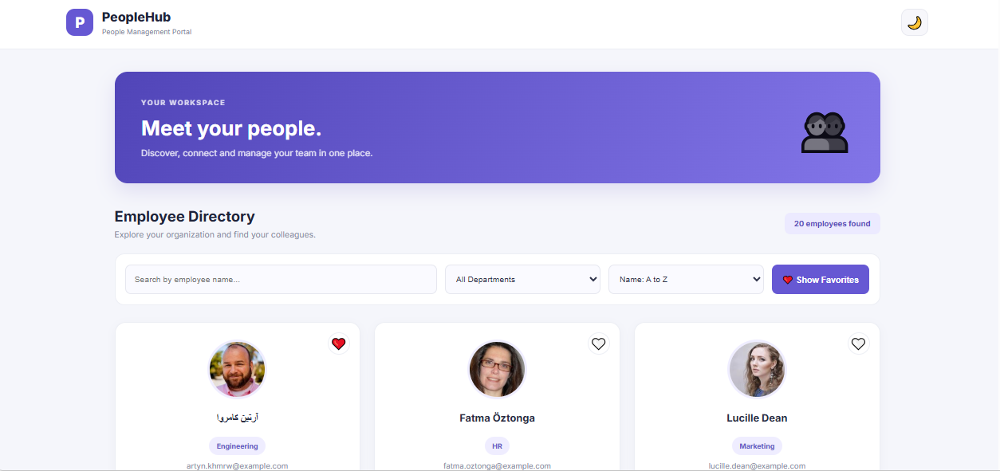
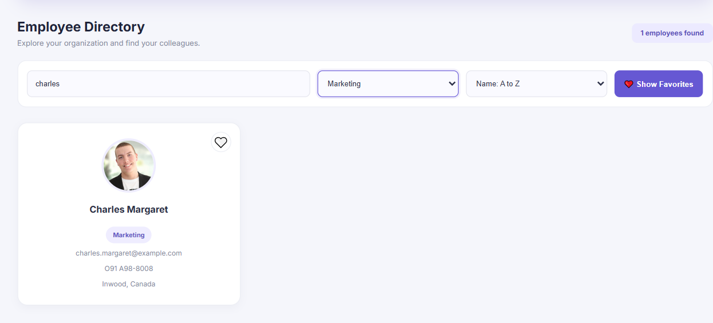
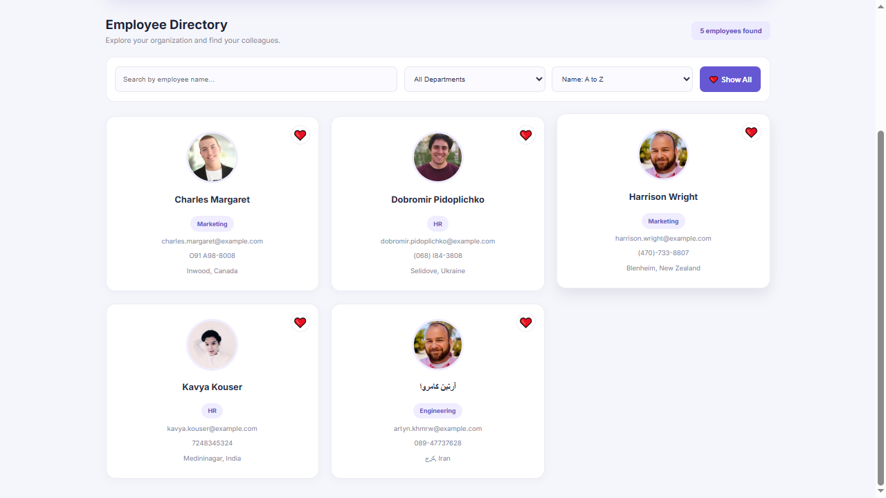
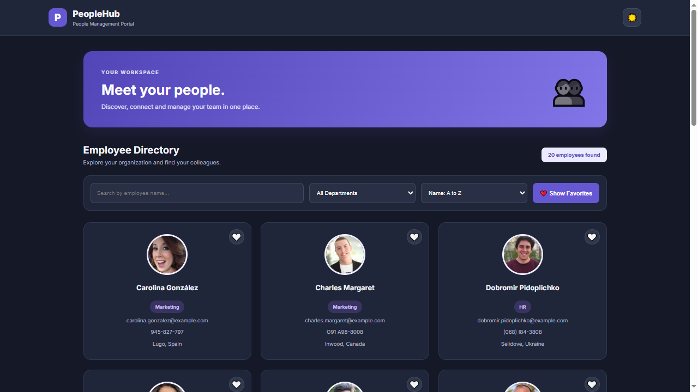

# Employee Directory Web Application

An interactive and responsive Employee Directory Web Application built using modern JavaScript (ES6+), HTML and CSS. The application fetches employee information from the Random User API and provides features to search, filter, sort and manage favorite employees.

## Features

- Fetch employee profiles using the Random User API.
- Display employee photos and contact information.
- Search employees by name.
- Filter employees by department.
- Sort employees alphabetically (A–Z and Z–A).
- Add and remove favorite employees.
- Save employee data and favorites using Local Storage.
- Dark mode with saved theme preference.
- Loading spinner and error handling with retry.
- Responsive design for different screen sizes.

## Technologies Used

- HTML5
- CSS3
- JavaScript (ES6+)
- Fetch API
- Async/Await and Promises
- Local Storage
- Vite
- Random User API
- Git and GitHub

## API

This project uses the Random User API:

https://randomuser.me/api/?results=20

The API provides random user information, including names, email addresses, phone numbers, profile pictures and locations. Department categories are assigned locally within the application.

## Installation and Setup

1. Clone the repository:

   `git clone https://github.com/ImmadiRenuka/employee-directory.git`

2. Navigate to the project folder:

   `cd employee-directory`

3. Install dependencies:

   `npm install`

4. Start the development server:

   `npm run dev`

5. Open the local URL provided by Vite in your browser.

## Project Structure

```text
employee-directory/
├── public/
├── src/
│   ├── assets/
│   ├── css/
│   │   └── style.css
│   ├── js/
│   │   ├── api.js
│   │   ├── employees.js
│   │   └── storage.js
│   └── main.js
├── index.html
├── package.json
└── README.md
```

## Screenshots

### Dashboard


### Employee Search


### Favorites


### Dark Mode
